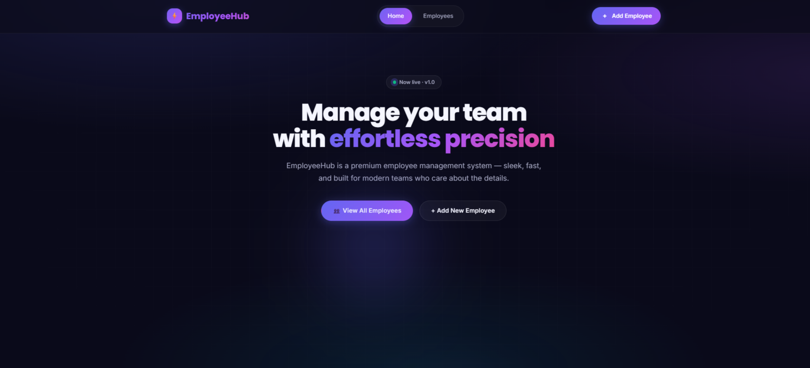
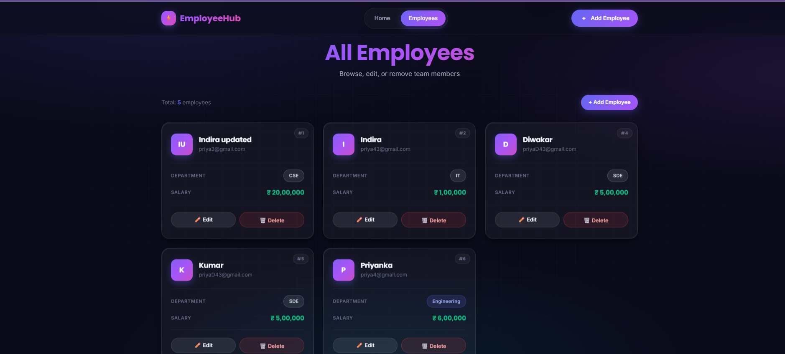
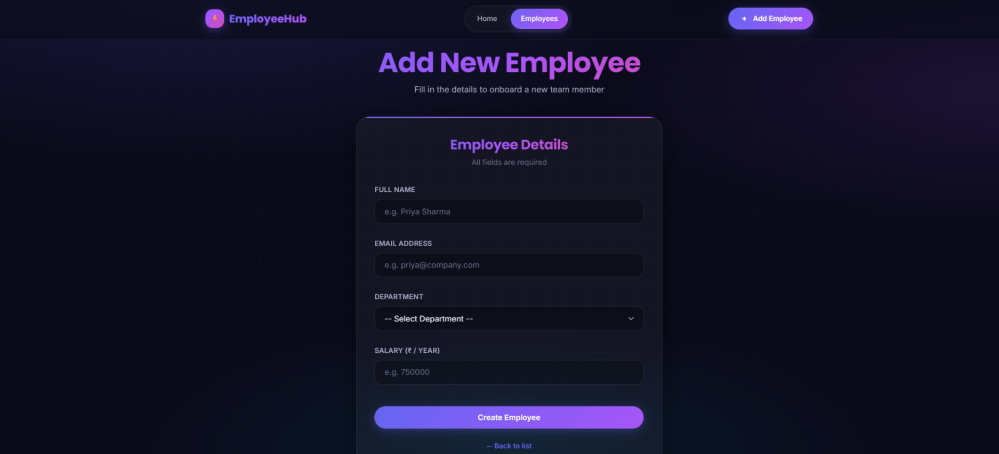

<div align="center">

# ⚡ EmployeeHub

### A Premium Employee Management System

**Full-Stack CRUD Application · Spring Boot + React**

[](https://spring.io/projects/spring-boot)
[](https://react.dev/)
[](https://vitejs.dev/)
[](https://www.mysql.com/)
[](https://openjdk.org/)

*Designed & Developed by **Indira Priyadarshini Nayak***

</div>

---

## 📖 Table of Contents

- [About the Project](#-about-the-project)
- [Features](#-features)
- [Tech Stack](#-tech-stack)
- [Project Structure](#-project-structure)
- [API Endpoints](#-api-endpoints)
- [Getting Started](#-getting-started)
    - [Prerequisites](#prerequisites)
    - [Backend Setup](#-backend-setup)
    - [Frontend Setup](#-frontend-setup)
- [Screenshots](#-screenshots)
- [Author](#-author)
- [License](#-license)

---

## 🎯 About the Project

**EmployeeHub** is a modern, full-stack **Employee Management System** built with **Spring Boot** on the backend and **React (Vite)** on the frontend. It provides a sleek, premium UI with glassmorphism, gradient accents, and buttery-smooth animations, while the backend delivers a robust REST API with validation, exception handling, and JPA-based persistence.

Whether you're managing 5 employees or 5,000, EmployeeHub makes CRUD operations feel effortless — clean code, clean architecture, clean design.

---

## ✨ Features

### 🎨 Frontend (React + Vite)
- 💎 **Premium UI** — Glassmorphism, gradients, and modern typography
- ⚡ **Blazing Fast** — Vite HMR for instant feedback
- 🎬 **Buttery Animations** — Fade-in, slide-up, hover-lift, shimmer
- 📱 **Fully Responsive** — Beautiful on mobile, tablet, and desktop
- 🔔 **Real-time Validation** — Mirrors backend rules on the client side
- 🧭 **Client-side Routing** — React Router v6 with active states
- 🎯 **Clean State Management** — Hooks-based, no unnecessary libraries

### 🔧 Backend (Spring Boot)
- 🏗️ **Layered Architecture** — Controller → Service → Repository
- ✅ **Bean Validation** — `@NotBlank`, `@Email`, `@Size`, `@DecimalMin`
- 🛡️ **Global Exception Handling** — Clean, structured error responses
- 🗄️ **JPA + Hibernate** — Auto DDL, clean entity mapping
- 🔄 **DTO Pattern** — Separate request/response DTOs with mapper
- 🌐 **CORS Configured** — Ready for local frontend development
- 📝 **Clean REST API** — Proper HTTP status codes and semantics

---

## 🛠 Tech Stack

### Backend
| Technology | Version | Purpose |
|------------|---------|---------|
| Java | 17+ | Language |
| Spring Boot | 3.x | Framework |
| Spring Data JPA | Latest | ORM / Persistence |
| Hibernate | Latest | JPA Provider |
| MySQL | 8.x | Database |
| Lombok | Latest | Boilerplate reduction |
| Jakarta Validation | Latest | Request validation |
| Maven | 3.8+ | Build tool |

### Frontend
| Technology | Version | Purpose |
|------------|---------|---------|
| React | 18 | UI library |
| Vite | 5.x | Build tool & dev server |
| React Router | 6.x | Client-side routing |
| Axios | Latest | HTTP client |
| CSS3 | — | Custom premium styling |

---

## 📁 Project Structure

```
Employee_Management/
│
├── employee-management/          # 🟢 Spring Boot Backend
│   ├── src/
│   │   ├── main/
│   │   │   ├── java/com/employee/employee_management/
│   │   │   │   ├── config/                 # CORS & other configs
│   │   │   │   ├── controller/             # REST controllers
│   │   │   │   ├── dto/
│   │   │   │   │   ├── request/            # Incoming DTOs
│   │   │   │   │   └── response/           # Outgoing DTOs
│   │   │   │   ├── entity/                 # JPA entities
│   │   │   │   ├── exception/              # Custom exceptions + handler
│   │   │   │   ├── mapper/                 # Entity ↔ DTO mappers
│   │   │   │   ├── repository/             # JPA repositories
│   │   │   │   ├── service/                # Service interfaces
│   │   │   │   │   └── impl/               # Service implementations
│   │   │   │   └── EmployeeManagementApplication.java
│   │   │   └── resources/
│   │   │       └── application.properties
│   │   └── test/
│   └── pom.xml
│
├── frontend/                     # 🔵 React Frontend
│   ├── public/
│   ├── src/
│   │   ├── api/                  # Axios setup & API calls
│   │   ├── components/           # Reusable UI components
│   │   ├── pages/                # Route-level pages
│   │   ├── styles/               # Modular CSS files
│   │   ├── utils/                # Constants, helpers
│   │   ├── App.jsx
│   │   └── main.jsx
│   ├── index.html
│   ├── package.json
│   └── vite.config.js
│
└── README.md
```

---

## 🔌 API Endpoints

**Base URL:** `http://localhost:8080`

| Method | Endpoint | Description | Status Codes |
|--------|----------|-------------|--------------|
| `POST` | `/api/employees` | Create a new employee | `201`, `400` |
| `GET` | `/api/employees/Indira` | Fetch all employees | `200` |
| `GET` | `/api/employees/{id}` | Fetch employee by ID | `200`, `404` |
| `PUT` | `/api/employees/{id}` | Update an employee | `200`, `400`, `404` |
| `DELETE` | `/api/employees/{id}` | Delete an employee | `204`, `404` |

### 📥 Sample Request Body (POST / PUT)

```json
{
  "name": "Indira Priyadarshini Nayak",
  "email": "indira@example.com",
  "department": "Engineering",
  "salary": 750000
}
```

### 📤 Sample Response

```json
{
  "id": 1,
  "name": "Indira Priyadarshini Nayak",
  "email": "indira@example.com",
  "department": "Engineering",
  "salary": 750000
}
```

### ⚠️ Error Response (Validation)

```json
{
  "email": "Please enter a valid email address",
  "salary": "Salary cannot be negative"
}
```

---

## 🚀 Getting Started

### Prerequisites

Make sure you have the following installed:

- ☕ **Java JDK 17+** — [Download](https://openjdk.org/)
- 📦 **Maven 3.8+** — [Download](https://maven.apache.org/)
- 🟢 **Node.js 18+** & **npm** — [Download](https://nodejs.org/)
- 🐬 **MySQL 8+** — [Download](https://dev.mysql.com/downloads/)
- 🧠 **IntelliJ IDEA** (or any Java IDE) — [Download](https://www.jetbrains.com/idea/)
- 💻 **VS Code** (recommended for frontend) — [Download](https://code.visualstudio.com/)

---

### 🟢 Backend Setup

1. **Clone the repository**
   ```bash
   git clone <your-repo-url>
   cd Employee_Management/employee-management
   ```

2. **Create the database**
   ```sql
   CREATE DATABASE employee_management;
   ```

3. **Configure `application.properties`**
   ```properties
   spring.datasource.url=jdbc:mysql://localhost:3306/employee_management
   spring.datasource.username=root
   spring.datasource.password=your_password

   spring.jpa.hibernate.ddl-auto=update
   spring.jpa.show-sql=true
   spring.jpa.properties.hibernate.format_sql=true
   ```

4. **Run the backend**
   ```bash
   mvn spring-boot:run
   ```
   Or run `EmployeeManagementApplication.java` from IntelliJ.

   ✅ Backend will start at: `http://localhost:8080`

5. **Verify it's running**
   ```
   http://localhost:8080/api/employees/Indira
   ```

---

### 🔵 Frontend Setup

1. **Navigate to the frontend folder**
   ```bash
   cd Employee_Management/frontend
   ```

2. **Install dependencies**
   ```bash
   npm install
   ```

3. **Start the dev server**
   ```bash
   npm run dev
   ```

   ✅ Frontend will start at: `http://localhost:5173`

4. **Open in browser**
   ```
   http://localhost:5173
   ```


---

## 🖼 Screenshots

> 





 


---

## 👩‍💻 Author

<div align="center">

### **Indira Priyadarshini Nayak**

*Full-Stack Developer · Java & React Enthusiast*

[](https://github.com/your-username)
[](https://linkedin.com/in/your-profile)
[](mailto:your-email@example.com)

</div>

---

## 📄 License

This project is licensed under the **MIT License** — feel free to use, modify, and learn from it.

```
MIT License

Copyright (c) 2026 Indira Priyadarshini Nayak

Permission is hereby granted, free of charge, to any person obtaining a copy
of this software and associated documentation files (the "Software"), to deal
in the Software without restriction, including without limitation the rights
to use, copy, modify, merge, publish, distribute, sublicense, and/or sell
copies of the Software, and to permit persons to whom the Software is
furnished to do so, subject to the following conditions:

The above copyright notice and this permission notice shall be included in all
copies or substantial portions of the Software.
```

---

<div align="center">

###  If you found this project helpful, please give it a star!

Built  by Indira Priyadarshini Nayak

</div>